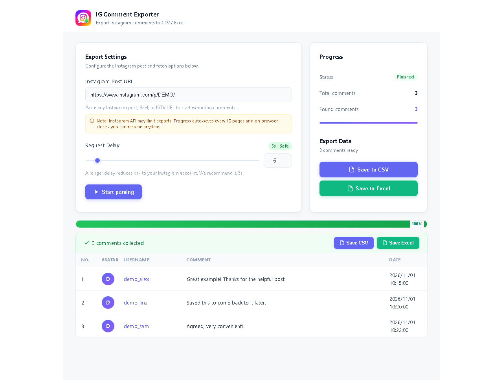
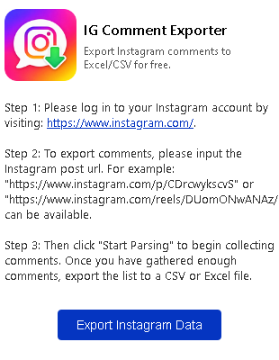
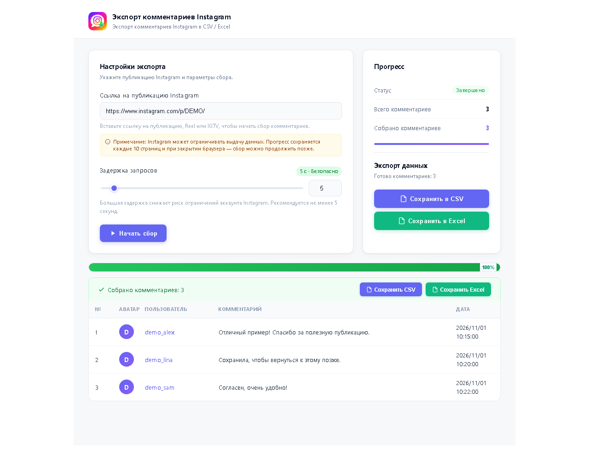
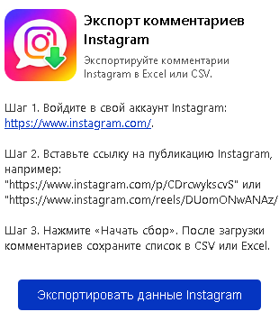

# Instagram Comment Exporter

<p align="center"></p>

**EN:** A Chrome extension for exporting Instagram comments and replies to CSV or Excel, with automatic English/Russian UI selection, saved progress, and links to individual comments.

**RU:** Расширение Chrome для экспорта комментариев и ответов Instagram в CSV или Excel: автоматический выбор русского/английского интерфейса, сохранение прогресса и переход к отдельным комментариям.

[English](#english) · [Русский](#русский) · [License](LICENSE.md) · [Third-party notices](THIRD_PARTY_NOTICES.md)

## English

### Features

- Export comments and replies, including author, text, date, profile URL and comment/parent identifiers.
- Save as CSV or Excel (.xlsx).
- Pause and resume using locally saved progress.
- Automatically select Russian for a Russian browser UI; use English otherwise.
- Open collected comments on Instagram and attempt to highlight them.
- Use the local interface without a subscription-service account; legacy subscription screens are hidden and their user/payment API requests are disabled.

### Screenshots

English interface. The main screen shows fictional demonstration comments, not data collected from a real Instagram account.





### Install in Chrome

1. Download the repository ZIP using **Code → Download ZIP** and extract it.
2. Open `chrome://extensions`.
3. Enable **Developer mode**.
4. Click **Load unpacked** and select the extracted directory containing `manifest.json`.
5. Sign in to Instagram in the same browser profile.
6. Open the extension, paste a post or Reel URL and start collecting comments.
7. Export the collected data to CSV or Excel.

After updating the files, click **Reload** on the extension card and reopen the options page. Existing tabs continue running the old scripts.

### Limitations and data

The extension uses Instagram endpoints that may change or restrict requests. A post's displayed count can differ from the number returned by its API; fetching every reported comment is not guaranteed. The current compatibility layer can normalize the finished progress display to the collected count and display a notice about the original count.

The existing bundled collector has a limit of 1,000,000 rows and bounded fallback pagination. A browser can run out of memory much earlier because comments are rendered and stored as a list.

Cookies are read to detect the Instagram session; comments and progress are kept in `chrome.storage.local`. Requests to Instagram use that browser session. Avatar images use an external image proxy in the inherited code. This is not an entirely offline application.

This project is independent of Instagram and Meta.

### Repository and checks

This repository contains a ready-to-load Manifest V3 extension and its compatibility layer. The original Vue/Webpack source tree and build configuration are not included; source maps are retained as supplied artifacts. `npm run check` validates the shipped files; it does not rebuild those bundles.

Requirements for checks: Node.js 22 or newer. No npm dependencies are required.

```sh
npm run check
npm test
```

Icon regeneration is optional and requires Python 3.10+ and Pillow:

```sh
python -m pip install -r requirements-dev.txt
python scripts/build_icons.py
```

- `manifest.json`: permissions and entry points.
- `js/localization.js`: language selection, UI translations and local compatibility changes.
- `js/comment-links.js`, `js/instagram-comment-focus.js`: comment links and highlighting.
- `js/options.js`, `js/popup.js`, `js/background.js`, `js/chunk-vendors.js`: inherited bundles.
- `icons/logo_master.png`: generated icon master; smaller icons and favicon are derived from it.
- `tests/`: local regression checks.
- `scripts/check.js`: package integrity and syntax checks.

### License

Original contributions to this repository are offered under **PolyForm Strict License 1.0.0**, SPDX identifier `PolyForm-Strict-1.0.0`. The unmodified text is in [LICENSE.md](LICENSE.md).

This license permits use for its specified noncommercial purposes. It does not grant permission to distribute the software or make modifications or derivative works. This is a source-available project, not a permissively licensed open-source project.

Inherited code and third-party components are excluded from any relicensing claim and retain their respective rights and terms. See [THIRD_PARTY_NOTICES.md](THIRD_PARTY_NOTICES.md), including the provenance limitations of the supplied extension bundles.

## Русский

### Возможности

- Экспорт комментариев и ответов: автор, текст, дата, ссылка на профиль, идентификаторы комментария и родительской записи.
- Сохранение в CSV или Excel (.xlsx).
- Пауза и продолжение с сохранённого локально прогресса.
- Автоматический русский интерфейс для русской локали браузера, английский — для остальных.
- Переход к собранному комментарию в Instagram с попыткой подсветки.
- Локальный интерфейс без регистрации в сервисе подписки: старые окна подписки скрыты, запросы к API аккаунта и оплаты отключены.

### Скриншоты

Русский интерфейс. На основном экране показаны вымышленные демонстрационные комментарии, а не данные из реального аккаунта Instagram.





### Установка в Chrome

1. Скачайте ZIP репозитория через **Code → Download ZIP** и распакуйте его.
2. Откройте `chrome://extensions`.
3. Включите **Режим разработчика**.
4. Нажмите **Загрузить распакованное расширение** и выберите папку с `manifest.json`.
5. Войдите в Instagram в том же профиле браузера.
6. Откройте расширение, вставьте ссылку на публикацию или Reel и начните сбор.
7. Сохраните собранные данные в CSV или Excel.

После обновления файлов нажмите **Обновить** на карточке расширения и заново откройте страницу настроек: старые вкладки продолжают выполнять прежний код.

### Ограничения и данные

Instagram может изменять API и ограничивать запросы. Счётчик публикации может отличаться от числа реально выдаваемых комментариев. Получение всех заявленных комментариев не гарантируется. Текущий слой совместимости может пересчитать завершённый прогресс по собранному количеству и показать уведомление об исходном счётчике.

В унаследованном сборщике сохранён предел в 1 000 000 строк и ограничена пагинация резервного API. Память браузера может закончиться значительно раньше: комментарии хранятся и отображаются единым списком.

Cookies используются для проверки входа в Instagram; комментарии и прогресс сохраняются в `chrome.storage.local`. Запросы к Instagram используют текущую сессию браузера. Для аватаров унаследованный код использует внешний прокси изображений. Приложение требует сети.

Проект не связан официально с Instagram или Meta.

### Разработка и проверки

В репозитории находится готовое расширение Manifest V3 со слоем совместимости. Исходного дерева Vue/Webpack и конфигурации его сборки нет; карты исходников сохранены. Команда `npm run check` проверяет готовые файлы и не пересобирает исходные bundle-файлы.

Для проверок нужен Node.js 22 или новее; установка npm-зависимостей не требуется:

```sh
npm run check
npm test
```

Для необязательного пересоздания иконок нужны Python 3.10+ и Pillow:

```sh
python -m pip install -r requirements-dev.txt
python scripts/build_icons.py
```

### Лицензия

Собственные изменения проекта предоставляются по **PolyForm Strict License 1.0.0** (`PolyForm-Strict-1.0.0`). Полный неизменённый текст: [LICENSE.md](LICENSE.md).

Лицензия разрешает использование для указанных в ней некоммерческих целей и не предоставляет разрешения на распространение, модификацию или создание производных работ. Код доступен для ознакомления, но проект не является open source с разрешительной лицензией.

Лицензия не заменяет права на унаследованный код и сторонние компоненты. Их происхождение и ограничения описаны в [THIRD_PARTY_NOTICES.md](THIRD_PARTY_NOTICES.md).
